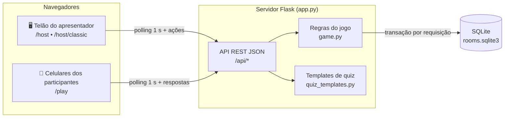

<div align="center">

# 🎮 Arena Quiz Multiplayer

**Plataforma de quiz ao vivo para eventos, salas de aula e treinamentos corporativos.**
O apresentador projeta a tela, os participantes entram pelo **QR code** no celular e todos jogam em tempo real.


[Visão geral](#-visão-geral) •
[Funcionalidades](#-funcionalidades) •
[Arquitetura](#-arquitetura) •
[Tecnologias](#-tecnologias) •
[Estrutura](#-estrutura-do-projeto) •
[Instalação](#-instalação-e-execução) •
[Publicação](#-publicação-no-pythonanywhere) •
[Documentação](#-documentação-prd-ptd-e-dtd) •
[Licença](#-licença-uso-gratuito-para-estudo)

</div>

---

## 📌 Visão geral

O **Arena Quiz Multiplayer** é uma aplicação web em **Python/Flask** que transforma qualquer quiz em uma competição ao vivo:

1. O organizador abre a tela de apresentador e cria uma sala (PIN de 4 letras + QR code).
2. Os participantes escaneiam o QR code, digitam o nome e entram, **sem instalar nada e sem criar conta**.
3. As perguntas aparecem ao mesmo tempo no telão e nos celulares. O **relógio é do servidor** e a pergunta fecha sozinha quando o tempo acaba.

A aplicação foi pensada para rodar em hospedagens simples, como o **PythonAnywhere**: não usa WebSockets (as telas consultam o servidor uma vez por segundo) e guarda o estado das salas em **SQLite**.

## ✨ Funcionalidades

| Área | Destaques |
|---|---|
| **Modos de jogo** | **Arena**: só o 1º a acertar pontua, com 9 poderes táticos (50/50, Dobro, Dado D6, Dica, Carta, Armadilha, Bloqueio, Lacre e Roubo). **Clássico**: todos pontuam por velocidade, com bônus de sequência, gráfico de respostas e pódio. |
| **Quem responde** | **O mais rápido** (todos ao mesmo tempo) ou **Por vez** (rodízio na ordem de entrada, com os outros acompanhando a jogada). |
| **Controles do apresentador** | Pausar, retomar, encerrar, próxima, avanço automático (3 a 60 s), finalizar, reiniciar, placar ao vivo, só entre perguntas ou só no final. |
| **🧰 Arsenal do organizador** | Efeitos para todos (50/50 geral, dobro, dica, +15 s, Dado da sorte, Carta surpresa), poderes contra um participante e envio de cargas. |
| **Interação** | Emojis do organizador no celular de todos, reações dos participantes no telão, "chamar atenção" com som alto e música de tensão. |
| **Salas** | Privadas (só com código/QR) ou públicas (pedido de entrada aprovado pelo organizador). Até 60 participantes por sala. |
| **Criação de quiz** | Templates prontos (corporativos e de diversão), importação JSON/CSV, texto rápido, editor visual e prompt pronto para IA. Enquetes sem resposta certa. |
| **Aparência** | 16 temas com 3 tons cada (programa de auditório, diversidade e inclusão, infantil e básicos), palco em tela cheia, maximizar janelas. |
| **Acessibilidade** | Modo acessível por aparelho (fonte Atkinson Hyperlegible, mais contraste, menos animação), sinais ✓/✗ além da cor. |
| **Idiomas** | Português, inglês e espanhol em todas as telas e no manual "Como Jogar". |

> 📖 O passo a passo de cada função está no [Manual completo](docs/MANUAL.md).

## 🧱 Arquitetura



- **Sincronização por polling**: cada tela chama `GET /api/state/<código>` a cada segundo. O servidor aplica o relógio (`tick`) a cada requisição: fecha a pergunta por tempo e faz o avanço automático.
- **Estado em SQLite**: cada sala é um documento JSON gravado dentro de uma transação (`BEGIN IMMEDIATE`) e só regravado quando muda, o que permite vários processos (workers) com o mesmo estado.
- **Visões por papel**: o apresentador e cada participante recebem visões diferentes. O gabarito só é enviado depois que a pergunta fecha.

Mais diagramas (sequência, estados, dados, implantação) estão em [`docs/diagramas`](docs/diagramas).

## 🧰 Tecnologias

| Camada | Tecnologia | Uso |
|---|---|---|
| Back-end | **Python 3.10+**, **Flask 2.3+** | Rotas, API REST e páginas (Jinja2) |
| Persistência | **SQLite** (biblioteca padrão) | Estado das salas, com limpeza automática após 24 h |
| QR code | **qrcode** | QR code SVG de cada sala |
| Front-end | **HTML + JavaScript puro** | Telas do apresentador e dos participantes, sem etapa de build |
| Estilo | **Tailwind CSS** (CDN), CSS próprio | Layout, temas e acessibilidade |
| Ícones e fontes | **Font Awesome 6**, **Google Fonts** (Inter, Orbitron) | Ícones e tipografia |
| Áudio | **Web Audio API** | Sons e música de tensão gerados em tempo real, sem arquivos de áudio |
| Testes | **pytest**, **Playwright** | 41 testes de regras e 7 roteiros de navegador |
| Documentação | **Mermaid**, **docx** (Node.js) | Diagramas e geração dos documentos PRD, PTD e DTD |
| Hospedagem | **PythonAnywhere** (ou qualquer servidor WSGI) | Publicação |

## 📁 Estrutura do projeto

```text
arena-quiz-multiplayer/
├── app.py                    # Servidor Flask: páginas, API REST, SQLite e QR code
├── game.py                   # Regras do jogo (modos, pontuação, poderes, arsenal); testável sem Flask
├── quiz_templates.py         # Templates de quiz prontos (PT/EN/ES)
├── default_quiz.json         # Quiz de exemplo
├── wsgi_pythonanywhere.py    # Modelo de arquivo WSGI para o PythonAnywhere
├── requirements.txt          # Dependências Python
├── LICENSE                   # PolyForm Noncommercial 1.0.0
├── templates/
│   ├── _head.html            # Cabeçalho comum (CSS, fontes, ícones)
│   ├── _host_modals.html     # Janelas: Configurar Jogo, Carregar Quiz, Como Jogar
│   ├── index.html            # Entrada por código e lista de salas públicas
│   ├── host.html             # Telão do modo Arena
│   ├── host_classic.html     # Telão do modo Clássico
│   ├── play.html             # Celular do modo Arena
│   └── play_classic.html     # Celular do modo Clássico
├── static/
│   ├── common.js             # Idiomas, chamadas à API, sons, manual "Como Jogar"
│   ├── i18n_extra.js         # Textos adicionais (PT/EN/ES)
│   ├── host_core.js          # Controles do apresentador, Arsenal e emojis
│   ├── fun.js                # Interações, temas, palco, acessibilidade e tela cheia
│   ├── quizkit.js            # Criação de quiz (templates, JSON, CSV, texto, editor, IA)
│   ├── style.css             # Visual do modo Arena
│   ├── corp.css              # Visual do modo Clássico
│   └── themes.css, showthemes.css, inclusion.css, kids.css   # Temas
├── tests/
│   ├── test_game.py          # Testes de regras (pytest)
│   ├── e2e.js … e2e7.js      # Roteiros de navegador (Playwright)
│   └── fixtures/             # Quizzes de exemplo (JSON e CSV)
└── docs/
    ├── MANUAL.md             # Manual completo de uso
    ├── PRD_Arena_Quiz_Multiplayer.docx
    ├── PTD_Arena_Quiz_Multiplayer.docx
    ├── DTD_Arena_Quiz_Multiplayer.docx
    ├── diagramas/            # 17 diagramas Mermaid (.mmd) e imagens (.png)
    └── gerador/              # Scripts que geram os documentos .docx
```

## 🚀 Instalação e execução

### Pré-requisitos
- Python **3.10** ou superior
- Git (opcional, para clonar o repositório)

### Passo a passo

```bash
git clone https://github.com/luiskenji-ido/arena-quiz-multiplayer.git
```

```bash
cd arena-quiz-multiplayer
```

Crie e ative um ambiente virtual.

Windows (PowerShell):

```bash
python -m venv .venv
.venv\Scripts\Activate.ps1
```

macOS / Linux:

```bash
python3 -m venv .venv
source .venv/bin/activate
```

Instale as dependências e rode o servidor:

```bash
pip install -r requirements.txt
```

```bash
python app.py
```

Abra **http://localhost:5000/host** para criar uma sala. Para jogar com celulares na mesma rede Wi-Fi, abra o telão por **http://IP-DO-SEU-COMPUTADOR:5000/host**: o QR code usa o endereço acessado.

### Variáveis de ambiente

| Variável | Padrão | Descrição |
|---|---|---|
| `HOST_PASSWORD` | *(vazia)* | Senha para criar salas. Recomendada em produção. |
| `QUIZ_DB` | `rooms.sqlite3` na pasta do app | Caminho do banco SQLite das salas. |
| `PORT` | `5000` | Porta do servidor local. |
| `DEBUG` | *(vazia)* | Qualquer valor ativa o modo debug do Flask. |

## 🌐 Publicação no PythonAnywhere

1. Crie uma conta em [pythonanywhere.com](https://www.pythonanywhere.com) e abra um **Bash console**.
2. Clone o repositório:
   ```bash
   git clone https://github.com/luiskenji-ido/arena-quiz-multiplayer.git ~/arena_multiplayer
   ```
3. Crie o ambiente virtual e instale as dependências:
   ```bash
   mkvirtualenv arena --python=python3.10
   ```
   ```bash
   pip install -r ~/arena_multiplayer/requirements.txt
   ```
4. Na aba **Web**, escolha **Add a new web app → Manual configuration** e a mesma versão do Python.
5. Em **Virtualenv**, informe `/home/SEU_USUARIO/.virtualenvs/arena`.
6. Abra o **WSGI configuration file** e cole o conteúdo de [`wsgi_pythonanywhere.py`](wsgi_pythonanywhere.py), trocando `SEU_USUARIO` e a senha do apresentador.
7. (Opcional) Em **Static files**, mapeie `/static/` para `/home/SEU_USUARIO/arena_multiplayer/static`.
8. Clique em **Reload**. O app fica em `https://SEU_USUARIO.pythonanywhere.com`.

> Planos gratuitos têm cota diária de CPU. Como cada tela consulta o servidor a cada segundo, turmas grandes funcionam melhor em plano pago. Detalhes no [Manual](docs/MANUAL.md#publicar-no-pythonanywhere).

## 🔌 API (resumo)

| Método | Rota | Descrição |
|---|---|---|
| `POST` | `/api/room` | Cria a sala e devolve código e token do apresentador |
| `POST` | `/api/join` | Participante entra com o nome |
| `GET` | `/api/state/<código>` | Estado da sala (visão do apresentador ou do participante) |
| `POST` | `/api/host/<código>/<ação>` | Ações do apresentador: `start`, `next`, `pause`, `settings`, `hostpower`, `hostemoji`… |
| `POST` | `/api/answer` | Envia a resposta |
| `POST` | `/api/power` | Usa um poder (modo Arena) |
| `POST` | `/api/nudge` • `/api/react` | Chamar atenção e reações |
| `GET` | `/api/public` | Lista de salas públicas (sem revelar o código) |
| `GET` | `/api/templates` | Templates de quiz |

A especificação completa, com entradas, saídas e códigos de erro, está no **DTD**.

## 📝 Formato do quiz (JSON)

```json
[
  {
    "block": "Tema",
    "question": "Qual é a capital da França?",
    "options": ["Londres", "Paris", "Madri", "Roma"],
    "correct": 1,
    "hint": "Torre Eiffel",
    "explanation": "Paris é a capital da França.",
    "time": 20
  },
  { "question": "Como foi o treinamento?", "options": ["Ótimo", "Bom", "Regular"], "poll": true }
]
```

Campos opcionais: `topic`, `reference`, `hint`, `explanation`, `time` (5 a 300 s), `image` (URL http/https) e `poll` (enquete). CSV e texto rápido também são aceitos (veja o [Manual](docs/MANUAL.md#formas-de-criar-o-quiz-botão-carregar-quiz)).

## 🧪 Testes

Testes de regras (pytest):

```bash
pip install pytest
```

```bash
pytest -q tests
```

Roteiros de navegador (Playwright, opcionais). Em um terminal, suba o servidor de teste:

```bash
QUIZ_DB=/tmp/e2e.db PORT=5055 python app.py
```

Em outro terminal:

```bash
npm install playwright
```

```bash
npx playwright install chromium
```

```bash
node tests/e2e.js
```

## 📚 Documentação (PRD, PTD e DTD)

| Documento | Conteúdo | Arquivo |
|---|---|---|
| **PRD** – Product Requirements Document | Problema, personas, escopo, requisitos funcionais e não funcionais, métricas | [PRD_Arena_Quiz_Multiplayer.docx](docs/PRD_Arena_Quiz_Multiplayer.docx) |
| **PTD** – Product Technical Document | Arquitetura, componentes, sincronização, segurança, implantação e testes | [PTD_Arena_Quiz_Multiplayer.docx](docs/PTD_Arena_Quiz_Multiplayer.docx) |
| **DTD** – Detail Technical Document | Modelo de dados, API, máquina de estados, algoritmos, erros e front-end | [DTD_Arena_Quiz_Multiplayer.docx](docs/DTD_Arena_Quiz_Multiplayer.docx) |
| **Manual** | Guia completo de uso de todas as funções | [MANUAL.md](docs/MANUAL.md) |
| **Diagramas** | 17 diagramas Mermaid (`.mmd`) com imagens `.png` | [docs/diagramas](docs/diagramas) |

> O GitHub não abre `.docx` no navegador: clique no arquivo e use **Download raw file**.

<details>
<summary><b>Como regenerar os documentos e diagramas</b></summary>

Os documentos são gerados a partir de scripts Node.js em `docs/gerador`, com as imagens de `docs/diagramas`:

```bash
cd docs/gerador
```

```bash
npm install docx
```

```bash
bash gerar.sh
```

Para atualizar um diagrama, edite o `.mmd` e gere o `.png` com o [Mermaid CLI](https://github.com/mermaid-js/mermaid-cli) ou o [Mermaid Live Editor](https://mermaid.live).

</details>

## 🔒 Segurança

- Token aleatório do apresentador (comparação em tempo constante) e token por participante.
- Senha opcional para criar salas (`HOST_PASSWORD`).
- Gabarito só enviado depois que a pergunta fecha; visões filtradas por papel.
- Quiz validado no servidor (tamanho, número de alternativas, URLs de imagem).
- Limites de reações, emojis, chamadas de atenção e pedidos de entrada; textos escapados contra XSS.

## 🧭 Próximos passos

- [ ] WebSockets opcionais para hospedagens que suportam conexões persistentes
- [ ] Exportação de resultados (CSV/Excel) ao final da partida
- [ ] Banco de quizzes por organizador, com login
- [ ] Capturas de tela e GIF de demonstração neste README

## 🤝 Contribuindo

1. Faça um **fork** do projeto.
2. Crie uma branch: `git checkout -b minha-melhoria`.
3. Rode os testes (`pytest -q tests`) antes de enviar.
4. Faça o commit e abra um **Pull Request** explicando a mudança.

Sugestões e problemas: [abra uma Issue](https://github.com/luiskenji-ido/arena-quiz-multiplayer/issues/new) (a lista de Issues fica vazia até alguém abrir a primeira).

## 📄 Licença: uso gratuito para estudo

Este projeto é distribuído sob a **[PolyForm Noncommercial License 1.0.0](LICENSE)**.

| ✅ Permitido gratuitamente | ❌ Não permitido sem autorização |
|---|---|
| Estudo pessoal, pesquisa, testes e projetos de hobby | Vender o software ou serviços baseados nele |
| Uso por escolas, universidades e instituições de pesquisa | Uso dentro de empresas com finalidade comercial |
| Uso por ONGs, órgãos públicos e organizações de saúde | Incluir em produto ou plataforma paga |
| Modificar e redistribuir **sem fins comerciais** | Remover o aviso de copyright e a licença |

### Como usar gratuitamente para estudo

1. **Baixe ou clone** o repositório (botão **Code → Download ZIP**, ou `git clone`).
2. **Use, estude e modifique** livremente para fins não comerciais: estudo, aulas, pesquisa ou eventos de instituições de ensino.
3. Se **redistribuir** (inclusive versões modificadas), mantenha o arquivo [`LICENSE`](LICENSE) com a linha `Required Notice:` do autor.
4. Ao publicar trabalhos acadêmicos ou derivados, **cite o projeto**:
   > Arena Quiz Multiplayer – luiskenji-ido, 2026. Disponível em: https://github.com/luiskenji-ido/arena-quiz-multiplayer

### Uso comercial

Para uso comercial (empresas, eventos pagos, revenda ou SaaS), [clique aqui para abrir um pedido de licença comercial](https://github.com/luiskenji-ido/arena-quiz-multiplayer/issues/new?title=Licen%C3%A7a%20comercial&body=Empresa%2Finstitui%C3%A7%C3%A3o%3A%0AComo%20pretende%20usar%3A%0AN%C3%BAmero%20aproximado%20de%20participantes%3A%0A) (abre uma Issue já com o título **"Licença comercial"**) para combinar uma licença separada.

> O software é fornecido "como está", sem garantias. Leia o texto completo em [`LICENSE`](LICENSE).

---

<div align="center">

Feito por **[luiskenji-ido](https://github.com/luiskenji-ido)** · ⭐ Se o projeto foi útil, deixe uma estrela!

</div>
